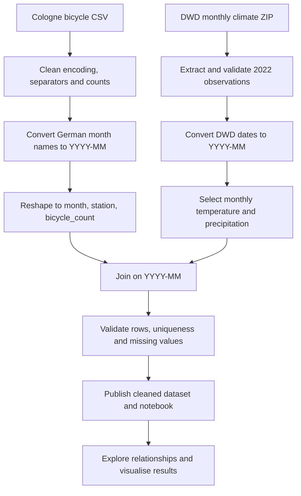

Cycling and Weather in Cologne

Subtitle: An Exploratory Analysis of Bicycle Traffic and Weather Conditions in 2022

Course: Data Integration – TH Köln, Winter Semester 2026/2027

Project format: Individual project (subject to lecturer approval)

Project owner: Karina Jacob

Milestone 1: Roadmap — 13 November 2026
1. Project Overview
This project investigates the relationship between weather conditions and bicycle traffic in Cologne during 2022. It will combine the City of Cologne's monthly counts from 17 bicycle counting stations with historical monthly weather observations from the Deutscher Wetterdienst (DWD), using the Köln/Bonn weather station (station ID 02667).

The aim is to create a reproducible, documented data-integration workflow and explore correlations between bicycle counts, average temperature, and precipitation. The analysis will not attempt to establish causality: there are only twelve monthly observations per counting station, and seasonality and location-specific factors may affect the findings.

2. Data Sources and Licences
Source	Original publisher	Coverage and format	Licence	Link
Fahrrad Verkehrsdaten Köln 2022	Stadt Köln	2022; monthly bicycle counts at 17 stations; CSV	Datenlizenz Deutschland – Zero – Version 2.0	Original publisher · Open.NRW record
Historical monthly climate observations, station 02667 (Köln/Bonn)	Deutscher Wetterdienst (DWD), Climate Data Center	2022 records to be extracted from a historical archive; weather station; zipped text data	CC BY 4.0 (subject to verification against the DWD terms accompanying the downloaded data)	DWD archive · Terms of use

2.1 Data already inspected
The original Cologne bicycle-count CSV was inspected in Lab 01. It contains 12 monthly records, 17 counter-station columns, and one month column (18 columns in total). There are 204 numerical bicycle-count values and no empty cells in this file. The CSV uses a semicolon separator, Latin-1 encoding, German month names, and a dot as the thousands separator. For example, 88.423 means 88,423 bicycles, not 88.423 bicycles.

The DWD archive lists a historical monthly file for station 02667. Its actual 2022 records, variable completeness, and units must be validated after downloading it; no weather summary statistics are asserted at this stage.
2.2 Source attribution and reuse
- Bicycle data: Fahrrad Verkehrsdaten Köln 2022. Author/publisher: Stadt Köln. Source: Offene Daten Köln / Open.NRW. Licence: Datenlizenz Deutschland – Zero – Version 2.0. Planned changes: normalise numbers and dates, reshape station columns, and join with weather data. Attribution is provided for transparency, although the Zero licence does not require it.
- Weather data: Monthly climate observations, station 02667 (Köln/Bonn). Author/publisher: Deutscher Wetterdienst (DWD). Source: DWD Climate Data Center. Licence: CC BY 4.0, subject to confirmation in the downloaded data's terms. Planned changes: select 2022 observations, standardise dates, and merge with bicycle counts. The DWD must be credited when reused under CC BY 4.0.
The combined output is planned for publication under CC BY 4.0 with source-specific attribution, licence links, and a clear statement of modifications. The repository's MIT licence, if used for original software code, does not override the upstream data licences.

3. Research Questions
1. Temperature: Is bicycle traffic in Cologne higher during months with higher average temperatures?
2. Precipitation: How does monthly precipitation relate to bicycle traffic volume?
3. Location differences: Do individual bicycle counting stations show different relationships between weather conditions and bicycle traffic?
These questions require joining two independently published datasets. The results will be descriptive and exploratory; a single year's monthly observations cannot establish causal relationships.
4. Data Integration Approach
The common integration key will be the calendar month, represented as YYYY-MM.
Source	Published date example	Standardised join key
Cologne bicycle CSV	Januar (year 2022 in the dataset title)	2022-01
DWD monthly climate file	MESS_DATUM_BEGINN = 20220101 (expected field representation; to verify in downloaded source)	2022-01

Planned output schema:
Field	Meaning	Expected type
month	Month in YYYY-MM format	String/date-period
counter_station	Name of the Cologne counting station	String
bicycle_count	Bicycle count at the station during that month	Integer
temperature_c	Monthly mean air temperature at station 02667	Numeric; °C
precipitation_mm	Monthly precipitation at station 02667	Numeric; mm

The planned structure is 12 months × 17 stations = 204 rows, provided that all 2022 DWD months are available and each month joins exactly once. The expected output size is a validation target, not a result of a completed join.

5. Roadmap and Milestones
Date / period	Milestone	Planned activities	Deliverables
13 Nov 2026	Milestone 1 – Roadmap	Select topic and datasets; document licences, research questions, integration approach and risks	This README.md in the public project repository
16–27 Nov 2026	Acquire and validate sources	Download DWD archive; inspect 2022 observations; verify units, completeness, source licences and station metadata	Source inventory, initial data-quality notes
30 Nov–11 Dec 2026	Build integration pipeline	Implement CSV imports and German number parsing; convert dates; reshape bike counts; join with DWD; add validation checks	Initial Jupyter notebook and pipeline prototype
14–18 Dec 2026	Milestone 2 – Dataset	Publish cleaned and enriched dataset; document cleaning, provenance, licences and data dictionary; prepare World Café	Online dataset, reproducible notebook, dataset documentation
Jan 2027, weeks 1–2	Analyse and visualise	Produce monthly charts, scatter plots and station comparisons; discuss limitations	Analysis figures, preliminary findings
By 22 Jan 2027 (verify deadline)	Repository freeze	Complete notebook, project documentation, slides and demonstration; check exact repository cutoff date with lecturer	Final repository state
25 Jan 2027	Milestone 3 – Presentation	Present results and demonstrate the running notebook	Presentation, running notebook and public code repository

Deadline clarification: The assignment states the exam on 25 January 2027 but gives a repository grading cutoff of 22 January 2026. This is inconsistent. 22 January 2027 is assumed in this roadmap only as a planning date and must be confirmed with the lecturer.

6. Methods and Tools
- Python and pandas: reading, cleaning, reshaping, and joining data.
- Jupyter Notebook: documenting the reproducible processing pipeline and analysis.
- Matplotlib: visualising bicycle traffic trends and relationships to weather conditions.
- Git and GitHub: version control, repository-based project documentation and milestone submission.
- CSV: publishing the combined machine-readable dataset.

7. Risks and Quality Assurance
Risk	Potential effect	Mitigation
Only one year of monthly observations	Weak statistical power; seasonal confounding	Report descriptive findings and avoid causal claims
DWD Köln/Bonn is not the exact location of all bike counters	Local weather differences	State spatial-proxy limitation and retain station metadata
German CSV formats and encoding	Incorrect parsing of bicycle counts or names	Explicit Latin-1, semicolon delimiter, thousands separator conversion; compare sample values
Missing or flagged DWD observations	Missing or misleading joined values	Inspect DWD quality and missing-value codes; validate coverage before joining
Inconsistent month formats	Join failures or duplicate records	Convert both datasets to YYYY-MM and check key uniqueness
Incomplete source documentation	Reduced reproducibility	Archive source links, download dates, data dictionary and transformation steps
Licence/provenance errors	Restrictions on legal redistribution	Confirm each source's current terms and preserve TASL attribution and modification notes

8. Definition of Done
Milestone 1
- [x] Project topic selected
- [x] Primary open dataset identified and inspected
- [x] Second official data source identified
- [x] Source licences documented, with pending DWD file-level verification noted
- [x] Three research questions defined
- [x] Integration approach and roadmap documented
- [ ] Lecturer's approval for an individual project confirmed
- [ ] Project repository created; lecturer invited as collaborator
- [ ] Project registration email sent to lecturer
Milestone 2
- [ ] Both source files downloaded and validated
- [ ] Reproducible processing notebook created
- [ ] Cleaned joined dataset published online
- [ ] Data dictionary, licences and provenance documented
- [ ] World Café presentation prepared
Milestone 3
- [ ] Research questions analysed and limitations discussed
- [ ] Slides completed
- [ ] Running notebook demonstration tested
- [ ] GitHub repository complete by the confirmed cutoff
      
9. References
1. Stadt Köln – Fahrrad Verkehrsdaten Köln 2022
2. Open.NRW – dataset metadata
3. Datenlizenz Deutschland – Zero – Version 2.0
4. DWD CDC – historical monthly climate observations
5. DWD CDC terms of use
6. Creative Commons Attribution 4.0 International
7. Open Definition

10. AI Assistance
AI assistance was used to structure and draft this roadmap. Any further use of AI tools, accepted changes and independent checks should be documented in AI_USAGE.md in accordance with the course rules. Source-file validation and weather-data analysis are not claimed as completed where they are still planned.
